<p align="center">
  
</p>

<p align="center">
  <a href="https://github.com/ishandutta2007/Awesome-Awesome-Awesome"></a><a href="https://discord.gg/jc4xtF58Ve"></a> <a href="https://github.com/ishandutta2007/Awesome-Web-Servers-Load-Balancers/stargazers"></a> <a href="https://github.com/ishandutta2007/Awesome-Web-Servers-Load-Balancers/network/members"></a> <a href="https://github.com/ishandutta2007/Awesome-Web-Servers-Load-Balancers/pulls"></a> <a href="https://github.com/ishandutta2007/Awesome-Web-Servers-Load-Balancers/blob/main/LICENSE"></a> <a href="https://github.com/ishandutta2007"></a>
</p>

---

# 🌐 Awesome Web Servers & Load Balancers ⚖️

> **The definitive, production-tested ecosystem directory of high-performance web servers, Layer 4 (L4) / Layer 7 (L7) load balancers, reverse proxies, ingress controllers, and enterprise Application Delivery Controllers (ADCs).**

Whether building zero-downtime microservices on Kubernetes, terminating SSL/TLS with HTTP/3 QUIC, scaling global Anycast edge routing, or maximizing bare-metal throughput with eBPF and DPDK, this guide aggregates the industry's top commercial SaaS solutions and battle-hardened open-source software.

---

## 📑 Table of Contents

- [📊 Sector Overview & Market Dynamics](#-sector-overview--market-dynamics)
- [☁️ SaaS & Managed Cloud Load Balancers](#️-saas--managed-cloud-load-balancers)
- [💻 Open-Source Web Servers & Load Balancers](#-open-source-web-servers--load-balancers)
- [🏗️ Architectural Comparison: L4 vs. L7 Balancing](#️-architectural-comparison-l4-vs-l7-balancing)
- [🛠️ How to Choose the Right Solution](#️-how-to-choose-the-right-solution)
- [🤝 How to Contribute](#-how-to-contribute)
- [📈 Star History](#-star-history)
- [💖 Support & Sponsoring](#-support--sponsoring)
- [📜 Disclaimer](#-disclaimer)

---

## 📊 Sector Overview & Market Dynamics

The global **Application Delivery Controller (ADC), web server, and software-defined load balancing** market is estimated at **$4.8B – $5.5B in 2025/2026**, projected to expand at an 11.5% CAGR to reach **~$9.8B by 2031**, driven by distributed cloud computing, microservices proliferation, zero-trust traffic security, and low-latency API delivery.

The sector exhibits a **moderately concentrated, bifurcated structure** rather than a single winner-take-all monopoly:
1. **Commodity Cloud Ingress**: The hyperscale cloud providers (**Microsoft Azure**, **Google Cloud**, and **Amazon Web Services**) capture dominant market volume for baseline L4/L7 ingress due to native VPC coupling and automated elastic scaling.
2. **Advanced Traffic & Edge Control**: A strong competitive tier of specialized ADC vendors (**F5/NGINX**, **Cloudflare**, **Akamai**, **Citrix NetScaler**, **A10 Networks**, **Progress Kemp**) maintains high-margin enterprise demand for multi-cloud global traffic management (GTM/GSLB), Web Application Firewall (WAF) integration, and hardware acceleration.
3. **Open-Source Data Planes**: Production engineering stacks are overwhelmingly dominated by open-source engines (**Envoy**, **HAProxy**, **NGINX**, **Traefik**, **Caddy**, **Pingora**), meaning enterprise SaaS vendors increasingly compete on management planes, compliance controls, and global Anycast telemetry rather than proprietary core proxy engines.

---

## ☁️ SaaS & Managed Cloud Load Balancers

The following table benchmarks notable enterprise SaaS and managed cloud load-balancing platforms. Entries are **sorted descending by company size / market valuation**.

| 🏢 Product / Platform | 🏷️ Provider / Parent | 💰 Company Size / Valuation | ⚙️ Capabilities & Focus | 🏷️ Specific Starting Price | 🎁 Free Tier / Trial Limit |
| :--- | :--- | :--- | :--- | :--- | :--- |
| **[Microsoft Azure Load Balancer](https://azure.microsoft.com/en-us/products/azure-load-balancer/)** | Microsoft Corp. *(NASDAQ: MSFT)* | **~$3.10 Trillion** *(Market Cap)* | Ultra-low latency L4 Layer 4 TCP/UDP load balancing, outbound SNAT, cross-region global tiers, and zonal redundancy across Azure regions. | **$0.025 / hour** (~$18.25/month for base rule set) + $0.005/GB data processed beyond first rules. | **Free forever on Basic SKU** (up to 300 backend instances); 30-day trial with **$200 free cloud credits**. |
| **[Google Cloud Load Balancing](https://cloud.google.com/load-balancing)** | Alphabet Inc. *(NASDAQ: GOOGL)* | **~$2.20 Trillion** *(Market Cap)* | Global Anycast single virtual IP (VIP) L4/L7 balancing, cross-region failover, Cloud CDN, and Google Cloud Armor integration. | **$0.025 / hour** for first 5 forwarding rules (~$18.25/month) + $0.008/GB for first 1 PB/month data processed. | **90-day free trial with $300 credits** across GCP; Always-Free Tier includes 1 e2-micro instance + 1 GB egress/month. |
| **[AWS Elastic Load Balancing (ELB)](https://aws.amazon.com/elasticloadbalancing/)** | Amazon.com, Inc. *(NASDAQ: AMZN)* | **~$2.00 Trillion** *(Market Cap)* | ALB (L7 HTTP/HTTPS/gRPC routing), NLB (L4 ultra-high performance & static IPs), and Gateway Load Balancer (GWLB for third-party appliances). | **$0.0225 / ALB-hour** (~$16.43/month) + $0.008/LCU-hour; NLB at $0.0225/hour + $0.006/NLCU-hour. | **12-month AWS Free Tier**: 750 hours/month shared between Application & Classic Load Balancers + 15 GB data processed/month. |
| **[Cloudflare Load Balancing](https://www.cloudflare.com/load-balancing/)** | Cloudflare, Inc. *(NYSE: NET)* | **~$36.0 Billion** *(Market Cap)* | Global Anycast traffic steering, zero-downtime geo-routing, health checks at the edge, dynamic failover, and local traffic affinity. | **$5.00 / month flat base** (includes 2 origin servers + 500,000 DNS queries/mo; +$5/mo per extra origin, +$0.50/500k queries). | **Free Plan includes unlimited DDoS, CDN & DNS**; Load Balancing add-on has no perpetual free tier, but includes basic DNS failover rules and 30-day enterprise proof-of-concept. |
| **[Citrix NetScaler ADC](https://www.netscaler.com/)** | Cloud Software Group *(Vista / Elliott)* | **~$16.5 Billion** *(Acquisition Valuation)* | Enterprise ADC software and hardware, global server load balancing (GSLB), app security, and microservice ingress acceleration. | **$0.45 / hour PAYG** on AWS/Azure Marketplace, or **$2,450 / year** base subscription for NetScaler VPX Standard (10 Mbps). | **90-day free trial** of NetScaler VPX Express (rate-limited to 20 Mbps throughput with full feature set unlocked). |
| **[Akamai Global Traffic Management](https://www.akamai.com/products/global-traffic-management)** | Akamai Technologies *(NASDAQ: AKAM)* | **~$15.2 Billion** *(Market Cap)* | DNS-based global traffic management (GTM), Anycast routing, edge health inspection, multi-cloud traffic distribution, and Linode NodeBalancers. | **$250.00 / month** base GTM platform commitment; Linode managed NodeBalancers start at **$10.00 / month** per instance. | **30-day trial with $100 free credits** on Akamai Connected Cloud / Linode (covers 10 NodeBalancers for a full month). |
| **[F5 BIG-IP / NGINX Plus](https://www.f5.com/)** | F5, Inc. *(NASDAQ: FFIV)* | **~$14.1 Billion** *(Market Cap)* | Flagship enterprise ADCs (virtual and hardware), plus NGINX Plus commercial software proxy with active health checks, dynamic reconfiguration, and JWT authorization. | **$3,500.00 / year** per NGINX Plus instance (~$0.48/hour PAYG); F5 BIG-IP Virtual Edition starts at **$1.03 / hour** on cloud marketplaces. | **30-day unrestricted free trial** of NGINX Plus with full features and enterprise modules; 30-day free evaluation for F5 BIG-IP VE. |
| **[Progress Kemp LoadMaster](https://kemptechnologies.com/)** | Progress Software *(NASDAQ: PRGS)* | **~$2.70 Billion** *(Market Cap)* | Cloud and on-premise hardware/virtual ADCs, automated SSL offloading, Layer 7 content switching, and reverse proxying with built-in WAF. | **$1,990.00 / year** for LoadMaster Standard annual subscription (or **$0.35 / hour** on AWS Marketplace for VLM-500). | **Free LoadMaster Community Edition** free forever (limited to 20 Mbps throughput); **30-day unrestricted trial** for Enterprise LoadMaster. |
| **[Fastly Traffic Management](https://www.fastly.com/products/load-balancing)** | Fastly, Inc. *(NYSE: FSLY)* | **~$1.25 Billion** *(Market Cap)* | Programmable edge load balancing, origin shielding, instant cache purge, dynamic backend routing, and canary traffic shifting via Varnish/VCL. | **$50.00 / month** base commitment + $0.12/GB bandwidth for first 10 TB + routing request fees. | **Free developer trial account** with **$50 / month in recurring free traffic credits** (renews every month with no expiry). |
| **[A10 Networks Thunder ADC](https://www.a10networks.com/products/thunder-adc/)** | A10 Networks *(NYSE: ATEN)* | **~$1.15 Billion** *(Market Cap)* | High-performance multi-gigabit L4/L7 load balancing, SSL/TLS decryption inspection, DDoS mitigation, and carrier-grade NAT. | **$0.55 / hour** on AWS/Azure Marketplace, or **$2,500 / year** perpetual virtual appliance license (vThunder 1 Gbps). | **30-day free trial** of vThunder virtual appliance with 1 Gbps throughput limit and full management access. |
| **[Radware Alteon VA](https://www.radware.com/products/alteon/)** | Radware Ltd. *(NASDAQ: RDWR)* | **~$920 Million** *(Market Cap)* | Next-generation application delivery controller with integrated SLA tracking, behavioral WAF, and automated SSL optimization. | **$0.62 / hour** on AWS/Azure Marketplace, or **~$3,000 / year** subscription per virtual appliance instance. | **30-day free marketplace trial** (software licensing fee waived for 30 days; underlying cloud compute charges apply). |
| **[HAProxy Enterprise](https://www.haproxy.com/products/haproxy-enterprise)** | HAProxy Technologies *(Private)* | **~$120 Million** *(Est. Valuation)* | Enterprise-hardened distribution of HAProxy with route health injection (RHI), native WAF, bot detection, Single Sign-On, and clustering dashboard. | **$3,800.00 / year** per production instance, or **$0.50 / hour** on AWS, GCP, and Azure Marketplaces. | **30-day free trial** of HAProxy Enterprise with all enterprise modules, clustering manager, and SLA support enabled. |

---

## 💻 Open-Source Web Servers & Load Balancers

Open-source technologies form the operational backbone of global web infrastructure. The repositories below are **ranked in descending order of current GitHub_Stars** with social Stars_Badges linking directly to each project's stargazers community.

---

### 1. [Caddy](https://github.com/caddyserver/caddy) [](https://github.com/caddyserver/caddy/stargazers)
- **Primary Language**: Go
- **Layer & Type**: Layer 7 Web Server, Reverse Proxy & Load Balancer
- **Key Features**: Automatic HTTPS via Let's Encrypt / ZeroSSL by default, HTTP/1.1, HTTP/2, and HTTP/3 QUIC support, modular Go architecture, dynamic JSON configuration API, and active health checks.
- **Best For**: Modern microservices, developer-friendly deployments, and zero-configuration TLS reverse proxying.

---

### 2. [Traefik](https://github.com/traefik/traefik) [](https://github.com/traefik/traefik/stargazers)
- **Primary Language**: Go
- **Layer & Type**: Layer 7 Cloud-Native Reverse Proxy & Ingress Controller
- **Key Features**: Auto-discovery of backends from Kubernetes, Docker, Swarm, Consul, and Nomad, automatic Let's Encrypt certificates, real-time dashboard, circuit breakers, rate limiting, and canary deployments.
- **Best For**: Microservice clusters, dynamic container environments, and Kubernetes ingress.

---

### 3. [Kong Gateway](https://github.com/Kong/kong) [](https://github.com/Kong/kong/stargazers)
- **Primary Language**: Lua / C (built on OpenResty/NGINX)
- **Layer & Type**: Layer 7 Cloud-Native API Gateway & Load Balancer
- **Key Features**: Plugin-oriented architecture (OAuth2, rate limiting, logging, caching), gRPC proxying, declarative configuration (decK), sub-millisecond core latency, and enterprise clustering.
- **Best For**: API management, service-to-service load balancing, and API security governance.

---

### 4. [Istio](https://github.com/istio/istio) [](https://github.com/istio/istio/stargazers)
- **Primary Language**: Go / C++ (built on Envoy Proxy)
- **Layer & Type**: Layer 4 & Layer 7 Service Mesh & Ingress Gateway
- **Key Features**: Advanced traffic shifting, canary rollouts, fault injection, mutual TLS (mTLS) enforcement, rich telemetry with OpenTelemetry/Prometheus, and declarative Kubernetes CRD APIs.
- **Best For**: Large-scale Kubernetes service meshes, zero-trust network security, and fine-grained traffic routing.

---

### 5. [NGINX](https://github.com/nginx/nginx) [](https://github.com/nginx/nginx/stargazers)
- **Primary Language**: C
- **Layer & Type**: Layer 4 & Layer 7 Web Server, Reverse Proxy & Load Balancer
- **Key Features**: Asynchronous event-driven architecture, handles 100,000+ concurrent connections with minimal RAM, upstream round-robin/least-conn/ip-hash load balancing, fast static file serving, and SSL/TLS offloading.
- **Best For**: Standard internet-facing reverse proxy, static file hosting, high-concurrency HTTP routing, and edge caching.

---

### 6. [Envoy Proxy](https://github.com/envoyproxy/envoy) [](https://github.com/envoyproxy/envoy/stargazers)
- **Primary Language**: C++
- **Layer & Type**: Layer 4 & Layer 7 Cloud-Native Edge and Service Proxy
- **Key Features**: Dynamic configuration via Discovery APIs (xDS), advanced load-balancing algorithms (zone-aware, least-request, ring hash, Maglev), circuit breakers, first-class gRPC/HTTP3 support, and deep observability.
- **Best For**: Modern cloud-native infrastructure, service mesh data planes, and Kubernetes gateway implementations.

---

### 7. [Pingora](https://github.com/cloudflare/pingora) [](https://github.com/cloudflare/pingora/stargazers)
- **Primary Language**: Rust
- **Layer & Type**: Layer 4 & Layer 7 Async Network Proxy Framework
- **Key Features**: Created by Cloudflare to replace NGINX at planetary scale; memory-safe async architecture built on Tokio, zero CPU thread contention, custom load-balancing logic, HTTP/1 and HTTP/2 proxying, and OpenSSL/BoringSSL integration.
- **Best For**: Building high-efficiency custom proxies, hyper-scale edge routers, and memory-safe network applications.

---

### 8. [Kubernetes Ingress-NGINX](https://github.com/kubernetes/ingress-nginx) [](https://github.com/kubernetes/ingress-nginx/stargazers)
- **Primary Language**: Go / Lua
- **Layer & Type**: Kubernetes Layer 7 Ingress Controller
- **Key Features**: The reference Ingress Controller for Kubernetes powered by NGINX; annotation-based route configuration, cert-manager integration, Lua plugins, URL rewrites, and SSL termination.
- **Best For**: Native Kubernetes cluster ingress and standard HTTP traffic routing.

---

### 9. [Apache APISIX](https://github.com/apache/apisix) [](https://github.com/apache/apisix/stargazers)
- **Primary Language**: Lua / C
- **Layer & Type**: Layer 7 Cloud-Native Dynamic API Gateway & Reverse Proxy
- **Key Features**: Ultra-fast routing using radixtree, dynamic configuration reloading without restarts via etcd, multi-protocol support (HTTP, gRPC, Dubbo, MQTT), canary releases, and 80+ out-of-the-box plugins.
- **Best For**: Dynamic microservices traffic control, API gateways, and high-concurrency API routing.

---

### 10. [OpenResty](https://github.com/openresty/openresty) [](https://github.com/openresty/openresty/stargazers)
- **Primary Language**: C / Lua
- **Layer & Type**: Programmable Web Platform & Reverse Proxy
- **Key Features**: Bundles standard NGINX core with LuaJIT, allowing developers to write ultra-fast, non-blocking Lua scripts directly inside the NGINX event loop for customized balancing, authentication, and routing.
- **Best For**: Custom security firewalls, dynamic routing engines, and programmable API gateways.

---

### 11. [Tengine](https://github.com/alibaba/tengine) [](https://github.com/alibaba/tengine/stargazers)
- **Primary Language**: C
- **Layer & Type**: Web Server & Load Balancer (Alibaba fork of NGINX)
- **Key Features**: Enhanced upstream health checks, dynamic module loading (DSO), active backend monitoring, advanced rate-limiting mechanisms, and optimizations tested under massive Singles' Day e-commerce traffic.
- **Best For**: High-load e-commerce infrastructures requiring enhanced upstream monitoring beyond vanilla NGINX.

---

### 12. [H2O](https://github.com/h2o/h2o) [](https://github.com/h2o/h2o/stargazers)
- **Primary Language**: C
- **Layer & Type**: Optimized HTTP/1, HTTP/2, HTTP/3 Web Server & Proxy
- **Key Features**: Exceptionally fast HTTP/2 priority scheduling, WebSocket proxying, early hints (RFC 8297), mruby configuration scripting, and TLS 1.3 / QUIC optimizations.
- **Best For**: Benchmarked HTTP/2 and HTTP/3 performance and low-latency asset delivery.

---

### 13. [MetalLB](https://github.com/metallb/metallb) [](https://github.com/metallb/metallb/stargazers)
- **Primary Language**: Go
- **Layer & Type**: Bare-Metal Kubernetes Layer 4 Load Balancer
- **Key Features**: Provides Kubernetes `Type=LoadBalancer` support on bare metal where cloud providers are absent; supports Layer 2 mode (ARP/NDP) and BGP routing mode with true multi-hop failover.
- **Best For**: On-premise, bare-metal, and edge Kubernetes clusters.

---

### 14. [Fabio](https://github.com/fabiolb/fabio) [](https://github.com/fabiolb/fabio/stargazers)
- **Primary Language**: Go
- **Layer & Type**: Zero-Conf HTTP(S) & TCP Router / Load Balancer
- **Key Features**: Integrates seamlessly with HashiCorp Consul; automatically creates routing tables from Consul service tags without configuration files or reload interruptions.
- **Best For**: HashiCorp ecosystem architectures (Consul + Nomad) and dynamic microservices.

---

### 15. [HAProxy](https://github.com/haproxy/haproxy) [](https://github.com/haproxy/haproxy/stargazers)
- **Primary Language**: C
- **Layer & Type**: Layer 4 & Layer 7 High-Availability Load Balancer & Proxy
- **Key Features**: Legendary stability, deterministic resource utilization, Stick Tables for stateful session persistence and DDoS protection, advanced health checking, SPOE engine, and sub-millisecond request processing.
- **Best For**: High-throughput mission-critical databases, high-volume websites, and rock-solid TCP/HTTP load balancing.

---

### 16. [BFE (Baidu Front End)](https://github.com/bfenetworks/bfe) [](https://github.com/bfenetworks/bfe/stargazers)
- **Primary Language**: Go
- **Layer & Type**: Layer 7 Modern Traffic Routing Engine
- **Key Features**: Open-sourced by Baidu; handles over 1 trillion requests daily; advanced condition-based routing expressions, pluggable architecture, multi-tenant separation, and TLS offloading.
- **Best For**: Enterprise multi-tenant traffic routing, content-based switching, and large-scale web services.

---

### 17. [Seesaw](https://github.com/google/seesaw) [](https://github.com/google/seesaw/stargazers)
- **Primary Language**: Go / C
- **Layer & Type**: Layer 4 Linux Virtual Server (LVS) Load Balancer
- **Key Features**: Developed by Google for corporate infrastructure; supports Direct Routing (DR), DSR (Direct Server Return), Anycast VIPs, and active node synchronization.
- **Best For**: Enterprise data-center L4 load balancing with Direct Server Return throughput.

---

### 18. [Katran](https://github.com/facebookincubator/katran) [](https://github.com/facebookincubator/katran/stargazers)
- **Primary Language**: C++ / eBPF
- **Layer & Type**: Layer 4 Ultra-Fast eBPF/XDP Load Balancer
- **Key Features**: Powers Meta's (Facebook) global infrastructure; leverages Linux kernel eBPF and XDP (eXpress Data Path) to forward packets directly at network card wire speeds, Maglev consistent hashing, and linear multi-core scaling.
- **Best For**: Ultra-high PPS (packets per second) environments and massive scale-out network edges.

---

### 19. [Varnish Cache](https://github.com/varnishcache/varnish-cache) [](https://github.com/varnishcache/varnish-cache/stargazers)
- **Primary Language**: C
- **Layer & Type**: HTTP Reverse Proxy, Accelerator & Director Load Balancer
- **Key Features**: High-performance HTTP caching, Varnish Configuration Language (VCL) compiled directly into C machine code, dynamic backend directors for load balancing, and Edge Side Includes (ESI).
- **Best For**: Content-heavy portals, high-hit-ratio reverse proxy acceleration, and e-commerce caching layers.

---

### 20. [Apache HTTP Server (httpd)](https://github.com/apache/httpd) [](https://github.com/apache/httpd/stargazers)
- **Primary Language**: C
- **Layer & Type**: Classic Web Server & Reverse Proxy (`mod_proxy`, `mod_proxy_balancer`)
- **Key Features**: The foundational web server of the internet; modular MPM (event, worker, prefork) architecture, `.htaccess` distributed configurations, robust SSL/TLS support, and flexible proxy balancing methods.
- **Best For**: Legacy enterprise web applications, PHP/CGI hosting, and environments requiring `.htaccess` decentralization.

---

### 21. [Contour](https://github.com/projectcontour/contour) [](https://github.com/projectcontour/contour/stargazers)
- **Primary Language**: Go
- **Layer & Type**: Kubernetes Ingress Controller powered by Envoy Proxy
- **Key Features**: CNCF graduating project; introduces `HTTPProxy` CRD for multi-team delegation of routing rules, dynamic Envoy configuration updates without connection dropping, and TLS wildcard support.
- **Best For**: Multi-team Kubernetes clusters requiring delegated route management and Envoy-grade observability.

---

### 22. [Kube-VIP](https://github.com/kube-vip/kube-vip) [](https://github.com/kube-vip/kube-vip/stargazers)
- **Primary Language**: Go
- **Layer & Type**: Kubernetes Virtual IP & Layer 4 Service Load Balancer
- **Key Features**: Provides Virtual IP management and L4 load balancing for both the Kubernetes control plane (API server HA) and `Type=LoadBalancer` user workloads via ARP/BGP.
- **Best For**: High availability Kubernetes control planes and bare-metal cluster networking.

---

### 23. [Gobetween](https://github.com/yyyar/gobetween) [](https://github.com/yyyar/gobetween/stargazers)
- **Primary Language**: Go
- **Layer & Type**: Modern Minimalist L4 TCP/UDP/TLS Load Balancer
- **Key Features**: Lightweight single binary, dynamic backend discovery (Docker, Consul, SRV records, JSON), multiple balancing algorithms (round-robin, least-conn, weight, ip-hash), and REST management API.
- **Best For**: Lightweight container environments, edge gateways, and uncomplicated TCP/UDP load balancing.

---

## 🏗️ Architectural Comparison: L4 vs. L7 Balancing

```
       [ Client Request ]
               │
      ┌────────▼────────┐
      │   Layer 4 LB    │ ─── (TCP/UDP, IP + Port routing, eBPF / LVS / NLB)
      └────────┬────────┘     Wire speed, no packet payload inspection
               │
      ┌────────▼────────┐
      │   Layer 7 Proxy │ ─── (HTTP/HTTPS/gRPC, URL Path, Cookies, Headers)
      └────────┬────────┘     SSL/TLS Termination, WAF inspection, Retries
               │
   ┌───────────┼───────────┐
   ▼           ▼           ▼
[App Node]  [App Node]  [App Node]
```

| Parameter | ⚡ Layer 4 (Transport Layer) | 🧠 Layer 7 (Application Layer) |
| :--- | :--- | :--- |
| **Inspection Scope** | IP address, TCP/UDP ports, protocol flags. | Full HTTP payload, URI path, headers, cookies, gRPC methods. |
| **Throughput & Latency**| Ultra-high throughput, near-zero CPU overhead (microsecond scale). | Moderate latency added due to TLS handshakes and packet parsing. |
| **TLS / SSL Handling** | Pass-through (SNI routing without decryption) or termination. | Full TLS termination, certificate management, and re-encryption. |
| **Routing Granularity**| Packet-level routing to server pools. | Route per path (e.g., `/api/v1` to Node A, `/static` to Node B). |
| **Typical Tools** | Katran (eBPF), Linux LVS/IPVS, AWS NLB, Azure Basic/Standard LB. | NGINX, HAProxy, Envoy, Traefik, Caddy, Cloudflare, AWS ALB. |

---

## 🛠️ How to Choose the Right Solution

1. **For Modern Cloud-Native & Kubernetes Ingress**:
   - Choose **[Traefik](https://github.com/traefik/traefik)** for out-of-the-box simplicity, auto-discovery, and built-in Let's Encrypt.
   - Choose **[Envoy](https://github.com/envoyproxy/envoy)** or **[Contour](https://github.com/projectcontour/contour)** for enterprise microservices, rich telemetry, and service-mesh architectures.
2. **For High-Performance Classic Web Serving & Reverse Proxying**:
   - Choose **[NGINX](https://github.com/nginx/nginx)** for battle-tested reliability, massive community documentation, and static asset acceleration.
   - Choose **[HAProxy](https://github.com/haproxy/haproxy)** when pure Layer 4/Layer 7 routing efficiency, zero-latency spikes, and advanced session stickiness are paramount.
3. **For Effortless Developer Experience & Automatic HTTPS**:
   - Choose **[Caddy](https://github.com/caddyserver/caddy)** for instant zero-configuration TLS and modern HTTP/3 defaults.
4. **For Memory Safety & Next-Gen High-Concurrency**:
   - Choose **[Pingora](https://github.com/cloudflare/pingora)** to craft custom Rust-based proxies free from memory leaks and thread locks.
5. **For Bare-Metal Kubernetes On-Premise**:
   - Deploy **[MetalLB](https://github.com/metallb/metallb)** or **[Kube-VIP](https://github.com/kube-vip/kube-vip)** for resilient L4 VIPs.

---

## 🤝 How to Contribute

Contributions are warmly welcomed! Help keep this ecosystem comprehensive, current, and factual.

1. 🍴 **Fork the repository** on GitHub.
2. 🌿 **Create a new branch**: `git checkout -b add-load-balancer-xyz`.
3. 📝 **Add or update the tool** in alphabetical or correct category order in `README.md`.
   - Ensure descriptions are factual, neutral, and include links to official repos/docs.
   - For SaaS additions, provide exact starting tier pricing, free limits, and company metrics.
   - For open-source repos, include the correct `shields.io` social badge.
4. 🚀 **Commit and push your changes**: `git commit -m "Add XYZ load balancer"`.
5. 📬 **Open a Pull Request** with a brief summary of why the addition is notable.

Please review our [Awesome Guidelines](https://github.com/ishandutta2007/Awesome-Awesome-Awesome) for quality benchmarks.

---

## 📈 Star History

[](https://star-history.dera.page/#ishandutta2007/Awesome-Web-Servers-Load-Balancers&type=date&legend=top-left)

---

## 💖 Support & Sponsoring

Thank you for exploring and utilizing **Awesome Web Servers & Load Balancers**! Curating, verifying pricing tiers, monitoring releases, and maintaining this ecosystem takes consistent effort. If this project helped your infrastructure engineering or cloud architecture decisions, please consider supporting:

- ⭐ **Star this repository** to improve visibility and help other platform engineers discover it.
- 🍴 **Fork & share** with your DevOps team, Reddit communities, Hacker News, and LinkedIn.
- ☕ **Buy me a coffee / Sponsor**: Back ongoing maintenance directly via the [GitHub Sponsor Dashboard](https://github.com/sponsors/ishandutta2007).

---

## 📜 Disclaimer

*This repository is a community-curated research directory and is not officially affiliated with or endorsed by any vendor or project listed. Pricing tiers, free quotas, and feature sets are verified as of October 2026 and are subject to change by respective providers. Always consult official vendor documentation before making production architecture or procurement decisions.*
